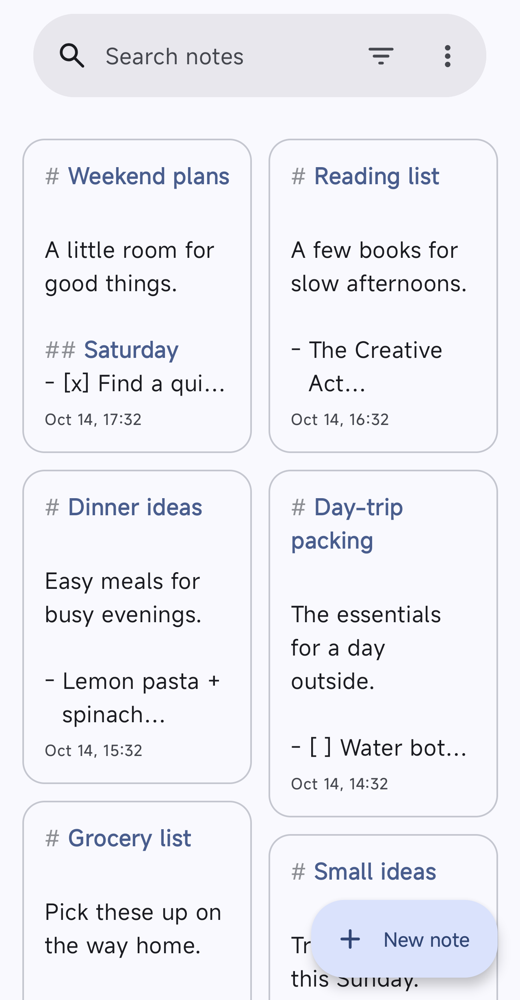
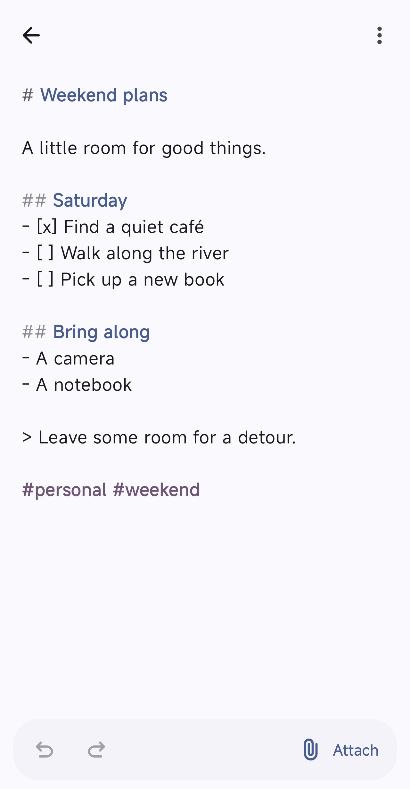

<h1 align="center">Memoize</h1>

A small, native Mac and Android client for [Memos](https://github.com/usememos/memos).

- Floating Markdown editor with syntax colors, file attachments, and smart lists
- Instant keyboard navigation, local search, and tag filtering
- Offline notes with automatic saves and background sync

**macOS**

<picture>
  <source media="(prefers-color-scheme: dark)" srcset="assets/screenshot-dark.png">
  <source media="(prefers-color-scheme: light)" srcset="assets/screenshot.png">
  
</picture>

**Android**

  <picture>
    <source media="(prefers-color-scheme: dark)" srcset="assets/screenshot-android-notes-dark.png">
    
  </picture>
  <picture>
    <source media="(prefers-color-scheme: dark)" srcset="assets/screenshot-android-editor-dark.png">
    
  </picture>

## Install

Download from [GitHub Releases](https://github.com/bgwastu/memoize/releases).

- **Mac:** macOS 26+, Apple silicon. Unzip and move Memoize.app to Applications.
- **Android:** Android 16+. Install the APK; a notes-list widget is included.

Enter your Memos URL and access token in Settings. Tested with Memos 0.31.0.

If macOS blocks the first launch, choose **System Settings → Privacy & Security → Open Anyway**.

## Shortcuts

| Shortcut | Action |
| --- | --- |
| ⌥⌘X | Show or hide Memoize; configurable |
| ⌘N | New note |
| ⌘[ / ⌘] | Older / newer note; past newest opens a blank draft |
| ⌘F / ⇧⌘F | Find in note / search all notes |
| ⌘` | Switch between notes list and editor |
| ⌘0 | Toggle the notes list |
| Return | Continue a Markdown list |
| Tab / ⇧Tab | Indent / outdent selected lines; nest / outdent a list at the caret |

On Android, select text and use the indent/outdent buttons to shift its lines.

## Development

Mac requires Xcode 26+. Build with `macos/Scripts/build.sh debug`.

Android: build locally with `android/gradlew -p android assembleDebug`.
Use the real device `adb connect atlas.mesh:5555`; no emulators.

Work directly on `main` with signed commits. CI builds and publishes only
the apps affected by a push; documentation and screenshots skip releases.
Run relevant checks locally.

AI disclosure: Human validated.
