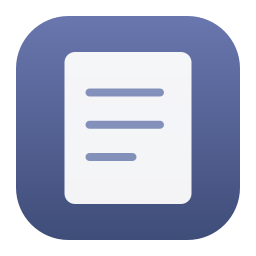
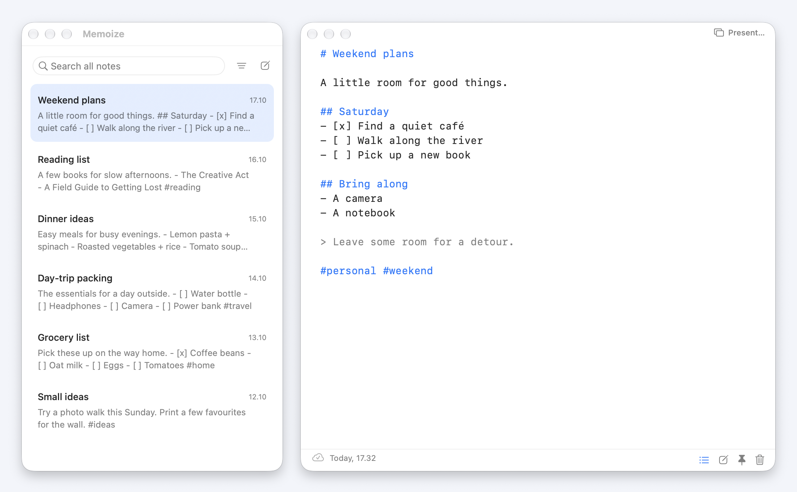

<p align="center"></p>

<h1 align="center">Memoize</h1>

A small, native Mac app for [Memos](https://github.com/usememos/memos). Capture a thought, browse your notes, and keep writing offline.

- Floating Markdown editor with syntax colors, file attachments, and smart lists
- Instant keyboard navigation, local search, and tag filtering
- Automatic saves and background sync, with conflict copies and confirmed deletion
- Hide notes from screen shares, configurable in Settings (experimental)

<picture>
  <source media="(prefers-color-scheme: dark)" srcset="assets/screenshot-dark.png">
  <source media="(prefers-color-scheme: light)" srcset="assets/screenshot.png">
  
</picture>

## Install

**macOS 26 or newer, Apple silicon.** Tested with Memos 0.31.0. Download Memoize from [GitHub Releases](https://github.com/bgwastu/memoize/releases).

### Mac — option 1: Terminal

Run this in an empty folder for a fresh install:

```sh
curl -fL -o Memoize.zip \
  "$(curl -fsSL 'https://api.github.com/repos/bgwastu/memoize/releases/latest' \
    | sed -nE 's/.*"browser_download_url": "(https:[^"]+\/Memoize-[^"]+\.zip)".*/\1/p' | head -n 1)" \
  && ditto -x -k Memoize.zip . \
  && xattr -cr Memoize.app \
  && mv Memoize.app /Applications/ \
  && rm Memoize.zip \
  && open /Applications/Memoize.app
```

The app is ad hoc signed and isn't notarized. `xattr -cr` clears its download quarantine. Later updates use Memoize's in-app updater.

### Mac — option 2: no Terminal

1. Download the newest `Memoize-*.zip` from [Releases](https://github.com/bgwastu/memoize/releases) and unzip it.
2. Drag **Memoize.app** into **Applications**, then open it.
3. If macOS blocks it, go to **System Settings → Privacy & Security → Open Anyway** after the first launch attempt. See [Apple's instructions](https://support.apple.com/en-us/102445).

Open Settings with **⌘,**, enter your Memos URL and access token, and connect.

## Shortcuts

| Shortcut | Action |
| --- | --- |
| ⌥⌘X | Show or hide Memoize; configurable |
| ⌥⌘S | Start a presentation / include or hide the shared note; configurable |
| ⌘N | New note |
| ⌘[ / ⌘] | Older / newer note; past newest opens a blank draft |
| ⌘F / ⇧⌘F | Find in note / search all notes |
| ⌘` | Switch between notes list and editor |
| ⌘0 | Toggle the notes list |
| Return / Tab / ⇧Tab | Continue a list / nest / outdent |

## Notes during screen sharing

Notes use solid native backgrounds. Making a note translucent does not prevent it from appearing in a screen share.

**Experimental entire-screen hiding:** open **Settings → General → Screen sharing** and enable **Hide notes in screen shares**. The preference is saved and updates the editor, library, Settings and attachment previews immediately. The editor shows **Hidden in screen shares** only while macOS reports an active screen capture, and removes the label when capture stops. Protection remains armed while the setting is enabled so it is already in place when sharing starts. Disable the setting to restore normal capture. Enabling it also stops the separate presentation.

On macOS 27.0.1 with Brave 155.0.8059.40, the actual editor passed an entire-screen WebRTC receiver test and a receiving window in Google Meet: protected notes disappeared completely, leaving the desktop behind them. The test used synthetic notes. The user also reported seeing the note over the green background on the Mac itself while sharing. This local observation is separate from the captured-video checks, which deliberately omit the protected window. The option defaults off. Apple explicitly does not guarantee capture exclusion with this flag, so it cannot promise privacy across every capture method or macOS/browser update. See the [research and test findings](docs/google-meet-notes-research.md).

For the separate filtered presentation:

Click **Present…** at the top of the editor, use **⌥⌘S**, or choose **Start Presentation…** in the Window or menu-bar menu. Allow Screen Recording access when macOS asks. With multiple displays, choose a screen; with one display, Memoize uses that screen.

In Google Meet, choose **Share screen → Window → Memoize Presentation**. This window contains the desktop with Memoize's windows excluded. Your local editor, notes list, Settings and attachment previews stay private in this output. This filter applies only to Memoize's own presentation; it does not modify Meet's entire-screen capture.

The note starts private. Click **Private note** or press **⌥⌘S** to add the visible writing area to the presentation; toggle **Note shared** to remove it. Editing and scrolling update the shared note. Resizing and local attachment previews remain available. **⌥⌘X** hides or restores your local notes while leaving the presentation running. Choose **Stop Presentation** or close its window to end capture. Frames are held in memory, with no audio capture or recording to disk. Check a harmless note from another participant before using this prototype in a real presentation.

## Development

Requires Xcode 26 or newer. From the project directory:

```sh
Scripts/build.sh debug
Scripts/test.sh
open build/Memoize.app
```

To check presentation controls with an isolated data directory:

```sh
MEMOIZE_DATA_DIR="$PWD/.build/screen-share-smoke" MEMOIZE_SMOKE_CAPTURE_ONLY=1 \
  build/Memoize.app/Contents/MacOS/Memoize --smoke-test
```

Add `MEMOIZE_SMOKE_PRESENTATION_CAPTURE=1` to also run the real filtered stream and capture the synthetic local note while it runs, if Screen Recording access is already available. These checks never request permission and never save captured desktop frames.

To test the presentation through an actual browser capture and decoded WebRTC receiver, with existing Screen Recording access:

```sh
npm install --prefix .build/presentation-browser-test --no-audit --no-fund playwright
bash Scripts/test-presentation-browser.sh
```

This uses a fresh native test store, a green synthetic desktop and an isolated Brave profile. Set `MEMOIZE_TEST_BROWSER` to another installed Chromium browser's executable if needed. It verifies private/shared toggles, live edits, resizing, local hide/restore and shutdown. It does not join Google Meet or use a Google account. On 11 October 2026, the live capture check and browser receiver test passed on macOS 27.0.1 with Brave's Chromium 155.0.8059.40.

To test the experimental native flag with ordinary **Entire Screen** capture instead, quit Memoize and run:

```sh
bash Scripts/test-native-screen-sharing.sh
# Exercise the actual Settings switch before and during capture:
bash Scripts/test-native-screen-sharing.sh --settings-ui
```

This uses the real editor with an isolated test store and a headed Brave session. It checks a visible baseline, native exclusion, editing, resizing, hide/restore, attachment-preview protection, restoring normal capture, and the automatic sharing indicator before, during and after capture. `--settings-ui` clicks the actual General Settings switch through Accessibility, including an off/on cycle before the first captured frame. It requires existing Accessibility access; the helper refuses to operate without the synthetic fixture window. The original privacy preference is restored after testing. Add `--hold` to keep the private test note and capture open briefly for a physical display check. A passing captured-video test cannot establish local readability or a universal privacy guarantee.

To check the saved Settings toggle, immediate window updates and indicator transitions with an isolated data directory:

```sh
MEMOIZE_DATA_DIR="$(mktemp -d "$PWD/.build/privacy-settings.XXXXXX")" \
  MEMOIZE_SMOKE_PRIVACY_SETTINGS=1 build/Memoize.app/Contents/MacOS/Memoize --smoke-test
```

Capture activity is a best-effort macOS signal, including screen recording rather than only Meet. The detector uses a dynamically resolved, read-only WindowServer query and never starts a capture. If the query is unavailable, the indicator stays hidden and enabled protection remains armed.

Earlier tests of the separate filtered presentation used an actual Google Meet call in two Brave windows on the same Mac, with microphone and camera off. The receiving window showed the shared note and live edits; resizing updated the writing area, and switching back to private removed the note. Local hide/restore preserved audience visibility. With experimental native hiding off, the local note remained readable during Meet entire-screen sharing. These checks cover this Mac and browser; a receiver on another device has not been tested.

`Scripts/test-screen-share.sh` preserves the rejected private-API experiment as a diagnostic. It captures synthetic windows; `--whole-display` selects display capture cropped to their opaque background. It never requests permission or saves captured frames. The API is not used by the app: during a live Meet entire-screen share, the user observed that it blanked the local note.

AI disclosure: Human validated.
