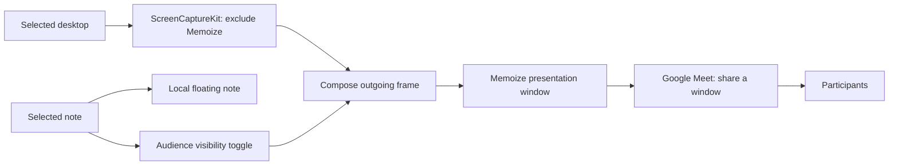

# Notes during Google Meet presentations

Research date: 10 October 2026; implementation update: 11 October 2026. This report combines primary documentation, a GitHub source audit, inspection of Memoize, and the user's live Meet feedback. The private capture-exclusion-shape trial failed to preserve the local note during entire-screen sharing. A filtered presentation requires sharing its own window. A subsequent opt-in native sharing-flag experiment passed ordinary entire-screen browser/WebRTC and receiving-window tests on this Mac, with local readability confirmed by the user.

The user's requirement is now explicit: keep a solid native note readable locally and completely absent from Google Meet's ordinary **Entire Screen** capture, without selecting a presentation window. Cosmetic translucency was reverted; it cannot make a visible window private. An opt-in native experiment now applies `NSWindow.SharingType.none` and passed outgoing full-screen tests on this Mac. The user subsequently reported seeing the green background and the note on the Mac itself while sharing. Native hiding is enabled for the normal installed app on this Mac. This confirms the tested setup, not an unconditional promise for every capture path.

Apple's current documentation calls `SharingType.none` a legacy value and says not to use it to omit captured content. The successful observations below do not override that documented limitation. The browser-specific PiP route also remains experimental, with exclusion disabled by default upstream and removed when another capturing frame participates. Neither route supports an unconditional full-screen privacy promise. [Apple window-sharing documentation](https://developer.apple.com/documentation/appkit/nswindow/sharingtype-swift.enum/none), [Chromium exclusion feature](https://chromium.googlesource.com/chromium/src/+/refs/heads/main/media/capture/capture_switches.cc), [Chromium capture coordinator](https://chromium.googlesource.com/chromium/src/+/refs/heads/main/content/browser/media/capture/pip_screen_capture_coordinator_impl.cc).

## Native entire-screen experiment, 11 October 2026

Memoize now has a saved **Hide notes in screen shares** toggle in **Settings → General → Screen sharing**, off by default. It sets the legacy sharing flag on the existing opaque editor, library, Settings and local attachment previews. New native content roots apply the flag before being shown; existing windows are updated when the setting changes. The system-owned menu-bar icon ignores this flag and contains no note. Enabling native hiding stops the separate presentation, whose window would otherwise also become uncapturable.

The **Hidden in screen shares** label appears only during detected capture and disappears when capture ends. Protection remains armed whenever the preference is enabled, including before the first shared frame. Activity comes from a passive, dynamically resolved `SLSIsScreenWatcherPresent` / `CGSIsScreenWatcherPresent` query polled every 500 ms. This is an undocumented, general capture signal, not a Meet-specific integration or a new recording session. If unavailable, it does not display a sharing claim and does not remove protection. The query approach was identified in the MIT-licensed [OpenUsage capture probe](https://github.com/robinebers/openusage/blob/bb7de176def23a99bbdcaabe1ac7269f18c738be/Sources/OpenUsage/Services/ScreenCaptureProbe.swift); the legacy Boolean signature is also present in [CGSInternal headers](https://github.com/NUIKit/CGSInternal/blob/master/CGSMisc.h). These primary source references establish the implementation precedent, rather than supported macOS API availability.

Tests on macOS 27.0.1 and Brave 155.0.8059.40:

- A whole-display ScreenCaptureKit screenshot and continuous stream omitted a synthetic protected native panel, while restoring `.readOnly` restored its pixels.
- An isolated headed Brave session used `getDisplayMedia` with `displaySurface: "monitor"` and decoded video through a WebRTC receiver. The **actual Memoize editor** appeared in the unprotected baseline. With native protection enabled, all 28,050 sampled pixels in the enlarged note area showed the green desktop behind it. Editing, resizing, hide/restore and the attachment-preview check passed; restoring normal capture showed the editor again.
- The updated Brave diagnostic verified an absent indicator before capture, a visible indicator during capture, immediate privacy disable/re-enable, and an absent indicator after all capture tracks stopped while the note remained protected. A focused Settings smoke test also passed preference persistence, immediate window updates, capture transitions, missing-query behavior, pane sizing and appearance restoration.
- `bash Scripts/test-native-screen-sharing.sh --settings-ui` exercised the actual General Settings switch through Accessibility. After an off/on cycle while idle, the first decoded WebRTC frame omitted the note. Turning the switch off during capture showed the note; turning it on removed the note again. Live editing, resizing, hide/restore, attachment-preview protection and capture-end indicator removal passed. WindowServer metadata sometimes reported sharing state 1 while AppKit reported `.none`; the captured-video tests establish the observed omission, and that metadata alone should not be treated as proof of protection failure or success.
- In an actual Google Meet call in two Brave windows, the host shared **Entire Screen** with camera and microphone off. The receiving window recognized the synthetic note when protection was disabled. With protection enabled again, no note text was recognized and all 7,040 sampled pixels showed the green desktop. This was complete omission rather than a gray replacement rectangle.
- A new actual Meet call repeated the protected → shared → protected receiver checks after adding Settings and capture detection. The indicator was absent while idle, appeared when Meet started entire-screen sharing, and disappeared after **Stop presenting** while the editor's protection remained enabled. The receiving-window checks again found 7,040/7,040 green pixels with privacy on and recognized the synthetic note with privacy off. Both owned call windows and the synthetic backdrop were closed afterward.

The earlier temporary standalone panel expired before the user could inspect it. A real-editor fixture then exited because its test incorrectly expected the system menu-bar icon to accept protection. That assertion was corrected to check content windows. The current physical display check uses the heading **Memoize full-screen privacy test** inside the actual editor, rather than relying on its hidden title bar. The user answered the physical-display check: “I guess I can. I see the green and the note.” This is a user observation of the local window, rather than an automated readability measurement; `isVisible`, cached AppKit text rendering and outgoing video alone cannot prove that the presenter sees the note during capture. The updated fixture supports a one-hour lifetime to avoid expiring before inspection. After this check, the owned Meet call and green backdrop were closed, the opt-in preference was enabled, and the installed app was reopened normally with the selected saved note.

The repeatable browser diagnostic is `bash Scripts/test-native-screen-sharing.sh`; it uses only a fresh test store, synthetic notes and an isolated browser profile. The Mac must be unlocked, and existing screen-capture authorization must be available. It does not join Meet. A different receiver device, macOS 26, other browser versions, capture-start transitions with saved notes and future OS updates remain unverified.

For private notes while presenting a tab or another application's window, the straightforward implementation is a floating meeting note with a local hide shortcut. The GitHub investigation identified the private window-server API `CGSSetWindowCaptureExcludeShape`, used in current Chromium source, as a direct experiment for entire-screen sharing. That experiment passed synthetic capture checks but turned the actual local note gray in the user's live Meet share. Memoize now implements a filtered desktop in a separate presentation window. The user selects **Memoize Presentation** as a window in Meet; with the native experiment off, directly sharing the entire screen still includes the local note. No documented AppKit window property reliably provides capture exclusion on Memoize's supported macOS versions.

There are two separate controls to design: **Show/hide my note**, which changes the presenter's local UI, and **Show/hide note for participants**, which changes outgoing content while leaving the local note available. Treat these as separate session state. The existing Memos `Note.visibility` field controls server visibility and is not an appropriate place to store presentation state. See [Models.swift](../Sources/MemoizeCore/Models.swift#L48).

Google Meet supports presenting a browser tab, a window, or an entire screen. That selection determines which content can reach participants. The following expected behavior follows from those capture boundaries and needs confirmation in the actual supported browser/OS combinations. [Google Meet presentation instructions](https://support.google.com/meet/answer/9308856?hl=en).

| Sharing arrangement | Keep the native note visible only to the presenter | Include the note without changing the shared source |
| --- | --- | --- |
| A Chrome tab | Yes, the native note is outside the tab | Requires rendering the note inside the tab or composing another output |
| Another application's single window | Yes, when only that window is captured | Requires composition; an independent floating panel is outside that window |
| The entire display containing the note | No documented general exclusion; Memoize's private-API trial blanked the local note | Normally included; direct entire-screen sharing is unsupported for private local notes |
| One display, with the note entirely on another unshared display | Yes | Move a copy onto the shared display, or compose it into another output |
| A Memoize presentation window containing a filtered desktop | Yes, by excluding Memoize from its own capture | Yes, by explicitly compositing the selected note into the output |

Apple's current documentation describes `NSWindow.SharingType.none` as a legacy value that macOS no longer uses, and explicitly advises against using it to hide content from capture. In a July 2025 response about ScreenCaptureKit capturing a supposedly excluded window on macOS 15.4+, Apple DTS said: “At this time there are no public APIs for preventing screen capture.” Memoize requires macOS 26+, so a proposal based on `panel.sharingType = .none` would not provide a defensible privacy guarantee. [Apple sharing-type documentation](https://developer.apple.com/documentation/appkit/nswindow/sharingtype-swift.enum/none), [Apple DTS response](https://developer.apple.com/forums/thread/792152).

Electron's `setContentProtection(true)` uses the same macOS window sharing flag. Its documentation explicitly says ScreenCaptureKit can still capture the window. Moving this feature to Electron would retain the platform limitation. [Electron BrowserWindow documentation](https://www.electronjs.org/docs/latest/api/browser-window#winsetcontentprotectionenable-macos-windows).

## GitHub implementation audit

The search followed actual uses of `setContentProtection`, `set_content_protected`, `sharingType`, `CGSSetWindowCaptureExcludeShape`, protected video layers, and capture detection. Code-search results were checked against repository source because some indexed snippets were stale or omitted commented-out code. The links below pin the inspected implementations where available.

| Alternative | Source evidence | Fit for Memoize |
| --- | --- | --- |
| Private window-region exclusion | Chromium calls `CGSSetWindowCaptureExcludeShape`; OTTO has an explicit native implementation of the same API | Rejected for this prototype after the user reported local blanking during a live Meet entire-screen share |
| Protected video rendering | Telegram contains image-to-video-layer code using `AVSampleBufferDisplayLayer.preventsCapture`, with important disabled paths | A possible read-only renderer experiment, not demonstrated whole-window exclusion |
| Detect capture and hide/redact locally | OpenUsage resolves the window-server watcher flag and registers capture notifications | Can automate local concealment; does not keep the concealed information visible to the presenter |
| Chromium Document PiP exclusion | Chromium's capture code excludes a PiP associated with the capturing frame under a feature flag | Requires browser integration and browser-version validation; does not apply to Memoize's existing native panel |
| Filter and compose an owned capture | Apple's ScreenCaptureKit sample demonstrates application exclusion | Documented native foundation for the presentation-window architecture described below |

**The strongest direct candidate is Chromium's window-region exclusion.** Its `ApplyCaptureExclusion` obtains the window-server connection and `NSWindow.windowNumber`, creates a region covering the window's frame with its origin reset to zero, and passes that region to `CGSSetWindowCaptureExcludeShape`. Passing a null region clears the exclusion. The bridge reapplies the region on resize and propagates its exclusion state to child window bridges. These are concrete implementation details we can reproduce in a small AppKit prototype; the presence of this code does not establish which released Chrome/Meet combinations honor it. [Chromium implementation, inspected commit](https://github.com/chromium/chromium/blob/a949c50b31c8330833020179fc0f60480c9936b7/components/remote_cocoa/app_shim/native_widget_ns_window_bridge.mm#L96).

[OTTO's native capture helper](https://github.com/ottoappmac/otto/blob/a3bd823bc00f8328f17d8859796a97335a87de13/app/src-tauri/src/stealth.rs#L127) calls the same API from Rust against an AppKit window. It uses an oversized region to avoid resize updates and clears the region to restore capture. The initial proposal preferred Chromium's bounded region and resize handling; the local prototype found a resize leak and now locks sizing while excluded, as described below. OTTO claims ScreenCaptureKit/browser exclusion, but its [feature pull request](https://github.com/ottoappmac/otto/pull/20) checks compilation and frontend build checks while leaving the real browser capture test unchecked. Its README also identifies capture paths that may bypass the exclusion. Treat this as a useful implementation reference, not evidence of verified Meet privacy.

The distribution limitation is concrete: an Electron user reported a Mac App Store rejection naming this API, and Electron subsequently removed it from its MAS build. Memoize currently uses direct GitHub distribution, so this does not block an isolated experiment, but adopting it would create an undocumented macOS dependency and complicate a future App Store version. [Electron rejection report](https://github.com/electron/electron/issues/49616), [merged MAS removal](https://github.com/electron/electron/pull/49633), [Memoize distribution](../README.md#install).

The initial read-only symbol check on the research machine, running macOS 27.0.1, resolved `CGSMainConnectionID`, `CGSSetWindowCaptureExcludeShape`, and `CGRegionCreateWithRect` from CoreGraphics. SkyLight also exposed the corresponding SLS connection/exclusion symbols. The subsequent prototype invoked the API and tested synthetic captures on that machine; macOS 26 compatibility and Google Meet behavior have not been established.

Suggested direct prototype, before building a new capture pipeline:

1. Add an isolated `WindowCaptureExclusion` helper using a small Objective-C/C bridge or runtime symbol resolution. Resolve all required symbols and preserve the API's return codes; missing symbols or errors must leave the capability unavailable.
2. Use a dedicated meeting-note `NSPanel`. Apply the region after the panel has a valid window number and before showing sensitive text. Keep the existing local show/hide shortcut separate from audience visibility.
3. Map **Private note** to the full-window exclusion region and **Show note to participants** to clearing that region. This is the intended behavior to test, not a promise that the capturing application honors it.
4. Reapply the region when the panel resizes or its backing window is recreated. Keep popovers, attachment previews, menus, and auxiliary windows out of the first prototype; protecting the main panel does not automatically protect every separate AppKit window.
5. Validate from a second Meet participant. Check entire-screen and explicit Memoize-window capture, toggles on a static desktop, resizing, movement, display changes, and the first frames after showing the panel. Determine whether exclusion reveals the underlying desktop, yields a blank rectangle, or is ignored. A successful API return is not an end-to-end privacy test.

**Protected video layers are a different rendering experiment.** Telegram's gallery view contains code that enqueues a sample buffer in an `AVSampleBufferDisplayLayer`, clears the normal image contents, and sets `preventsCapture = true`. However, the inspected gallery configuration explicitly sets its view's protection to false, and the analogous implementation in `TransformImageView` is commented out. This supports investigating the rendering technique, but not claiming that Telegram proves editable notes are reliably excluded from Meet. Memoize would need to rasterize note content, handle selection/editing separately, and test the surrounding unprotected UI. [Telegram gallery renderer](https://github.com/overtake/TelegramSwift/blob/579cebbf0c01fd41b712eff3647fa7f69db9665d/Telegram-Mac/MGalleryItem.swift#L449), [gallery protection disabled](https://github.com/overtake/TelegramSwift/blob/579cebbf0c01fd41b712eff3647fa7f69db9665d/Telegram-Mac/MGalleryItem.swift#L659), [commented image-view implementation](https://github.com/overtake/TelegramSwift/blob/579cebbf0c01fd41b712eff3647fa7f69db9665d/packages/TGUIKit/Sources/TransformImageView.swift#L97).

**Capture detection can automate local concealment.** OpenUsage uses runtime-resolved `SLSIsScreenWatcherPresent`/`CGSIsScreenWatcherPresent`, private watcher attach/detach notifications, and a three-second fallback poll to replace sensitive menu-bar content during capture. This is a useful Swift reference for an optional Memoize auto-hide setting. It is an any-capture signal, not identification of the specific Meet share, and notification/poll latency can expose initial frames. Its public fallback only detects remote sharing sessions, not ordinary in-app captures. [OpenUsage capture probe](https://github.com/robinebers/openusage/blob/bb7de176def23a99bbdcaabe1ac7269f18c738be/Sources/OpenUsage/Services/ScreenCaptureProbe.swift), [privacy store and polling](https://github.com/robinebers/openusage/blob/bb7de176def23a99bbdcaabe1ac7269f18c738be/Sources/OpenUsage/Stores/MenuBarPrivacyStore.swift#L21).

Several apparently relevant note apps do not add a new capture mechanism:

| Repository | Actual implementation inspected | Implication |
| --- | --- | --- |
| [Ghost Notes](https://github.com/navyabijoy/invisible-notes/blob/2b3e393af40dd2a1630c854b61f26f63270dec18/note/noteWindow.js#L13) | `win.setContentProtection(true)` | Same Electron protection API discussed above |
| [Sidenote](https://github.com/gurungabit/sidenote/blob/695ecb154b5de7d224704c701f7108b5ad9b21d8/src/main/window.ts#L63) | Wrapper around `win.setContentProtection(hidden)` | Useful UI reference; no different exclusion technique in this helper |
| [CueCard](https://github.com/thisisnsh/cuecard/blob/1ade6711bfeb745b4d41fbfd3eb4fe620d0ec9b8/cuecard-desktop/src-tauri/src/lib.rs#L1262) | Tauri `set_content_protected(enabled)` | The wrapper is not independent evidence of modern macOS exclusion; Tauri tracks an upstream limitation |
| [Detto](https://github.com/Gremble-io/Detto/blob/d0854bebed9884042a49825ef723dae13ccc4ba3/Detto/Sources/Detto/App/DettoApp.swift#L108) | Native Swift `window.sharingType = hidden ? .none : .readOnly` | Native implementation, but uses the same legacy AppKit property |

The framework source and issue reports are more useful for assessing these flags than product claims of invisibility. [Electron's macOS setter](https://github.com/electron/electron/blob/main/shell/browser/native_window_mac.mm), [Electron capture limitation report](https://github.com/electron/electron/issues/48258), [Tauri upstream issue](https://github.com/tauri-apps/tauri/issues/14200).

## Applying the alternatives to Memoize

### Rejected private-API trial

The original trial applied native exclusion to Memoize's editor panel. Its helper is preserved as a diagnostic in [WindowCaptureExclusion.swift](../Scripts/WindowCaptureExclusion.swift), outside the application target. It resolves private symbols at runtime, retains/releases the created region through Core Foundation ownership, and reports nonzero return codes. The app no longer calls it.

The capture probe found that growing an excluded window could leave newly added pixels visible, even after immediately reapplying the region. An oversized region did not fix this observed case. The trial locked interactive and programmatic sizing while hiding was enabled; this logic is preserved in [CaptureProbePanel.swift](../Scripts/CaptureProbePanel.swift). The replacement editor has normal resizing.

[The capture probe](../Scripts/ScreenShareProbe.swift), run with `bash Scripts/test-screen-share.sh`, captures only two synthetic windows. On macOS 27.0.1, snapshots showed 6,984 red fixture samples when visible, zero while excluded and after attempted resizing, and restored fixture samples after clearing exclusion. Resizing while visible followed by exclusion at the new size also produced zero red samples. A continuously running ScreenCaptureKit stream changed from 7,956 red samples to zero and back to 7,956, including toggles while the desktop was otherwise static. Earlier inspected snapshots replaced the protected content with a gray area rather than revealing the window underneath. Different capture paths may render the exclusion differently.

The trial's focused smoke check passed native API calls, size locking, local content/cursor preservation, attachment-preview dismissal/blocking, menu state, and title-bar hit testing. These assertions and AppKit bitmap snapshots did not prove that the physical display remained readable during a live Meet share. The user confirmed that the **actual floating Memoize window**, rather than only Meet's preview, turned gray while sharing the entire screen. This invalidated the direct exclusion approach for the user's setup.

The diagnostic also passed the same exclusion/restoration checks using display capture cropped to the opaque synthetic fixture background (`Scripts/test-screen-share.sh --whole-display`). Captured-pixel success still did not establish a usable local note during the user's Meet share. This distinction must remain explicit in future capture experiments.

### Implemented presentation-window replacement

[DesktopPresentation.swift](../Sources/Memoize/DesktopPresentation.swift) owns a ScreenCaptureKit desktop stream with the current Memoize application excluded through `SCContentFilter(display:excludingApplications:exceptingWindows:)`. This excludes the local editor, library, Settings, popovers, and output window, including future windows owned by the same application, without changing the local windows' capture properties. The stream captures no audio and writes no recording. Starting it requires Screen Recording access; a multi-display setup lets the user choose the source screen.

The presentation starts with the note private. The editor's **Private note / Note shared** control and **⌥⌘S** compose or remove a snapshot of the visible writing area. The private controls and attachment popovers are omitted from this overlay. A timer refreshes the note even when the desktop is static; hiding clears the overlay immediately. The note can still be edited, scrolled, resized, and hidden locally with **⌥⌘X**. Closing the output window, selecting **Stop Presentation**, or sleeping the Mac ends capture and clears the output. `--presentation-ready` launches with the note and library windows hidden for switching from an existing entire-screen share.

Meet must share **Memoize Presentation** as a window. Sharing the physical display bypasses Memoize's owned filter; without the separate native experiment enabled, it includes local notes. Check the new workflow from a receiver before relying on it. The focused smoke test checks private/default output, note composition, immediate hiding on an idle desktop, rendered local text, resizing, attachment previews, menu state, and shutdown. Its optional live mode also runs the production filtered stream and independently captures the synthetic local note while that stream is active; it never requests permission or saves captured desktop frames.

On macOS 27.0.1, the live filtered-stream test passed, including a separate ScreenCaptureKit snapshot showing readable text in the local synthetic note. [The browser diagnostic](../Scripts/test-presentation-browser.sh) also passed using an isolated Brave profile (Chromium 155.0.8059.40), real `getDisplayMedia` window capture, and two connected `RTCPeerConnection`s. It checked pixels decoded at the receiver: the private state omitted the local note; the shared state contained its text; edits and resizing updated the overlay; hiding/restoring the local note preserved the presentation and audience state; switching back to private cleared the receiver on an otherwise static desktop. No Google account or Google Meet meeting was used. These results validate the browser/WebRTC capture path on this machine, not Meet's service, other browsers, or macOS 26.

On 11 October 2026, a separate service test joined an actual Google Meet call in two windows of installed Brave 155.1.97.56 (Chromium 155.0.8059.40) on the same Mac, with both cameras and microphones off. The host selected **Window → Memoize Presentation** in Brave's sharing picker. Captures of only the receiving Brave window, checked visually and with text recognition, confirmed the original synthetic note, live replacement text, the resized overlay and continued presentation while the local note was hidden. Switching back to private and restoring the local editor both left zero non-green pixels in the sampled note region and no recognized fixture text. The test used an isolated native note store and a green desktop fixture; it did not expose saved notes or invite other people. An independent cropped display capture confirmed that the local note's desktop background showed through its writing area, with 7,347 contrasting text pixels. A Meet entire-screen sharing check also kept the local note readable. These results validate Meet on this Mac; they do not cover a second device, macOS 26, or another browser.

The floating note and writing area use solid native backgrounds again, following the user's clarification. A native composition check verifies that the writing-area snapshot is opaque. Privacy still depends on the capture filter; changing the editor's opacity never excludes it from someone else's screen capture.

Memoize already has most of the UI for a small first version:

- [NoteEditor.swift](../Sources/Memoize/NoteEditor.swift#L168) creates a floating `NSPanel` that remains visible when the app loses focus and supports other Spaces and full-screen applications.
- [NoteEditor.swift](../Sources/Memoize/NoteEditor.swift#L460) controls whether the panel stays above other windows.
- [SettingsWindow.swift](../Sources/Memoize/SettingsWindow.swift#L8) defines the configurable global shortcut, initially **⌥⌘X**.
- [AppController.swift](../Sources/Memoize/AppController.swift#L775) implements local show/hide; the hide notification flushes edits and remembers the editor position.

For that first version, add an optional compact meeting view of the selected note, readable text sizing, and an explicit local hide button. Keep privacy guidance conditional on the user's chosen sharing surface; the app cannot infer that a note is excluded just because meeting mode is enabled. A reader panel should be able to appear without activating Memoize, since the current editor `show()` method activates the app and focuses its text view. Separate panel construction is a reasonable way to support that behavior while retaining normal editing.

If the feature only means making a note disappear from everyone's screen, the existing shortcut already provides the essential behavior during entire-screen sharing. It also removes the note from the presenter's view. If the feature means directly presenting the note itself while retaining a private editor, a simpler extension is a separate note presentation window: share that window in Meet and render an empty state when the audience toggle is off. Keep the shared window alive so clearing its content does not depend on how the browser handles a disappearing capture source.

For the complete desktop-plus-note feature, the proposed native architecture is:

ScreenCaptureKit provides filters for excluding windows or applications from a stream controlled by the capturing app. The important ownership distinction is that Memoize can filter **its own** stream; it cannot apply that filter to Chrome's independently created Meet stream. Excluding the entire Memoize application is a useful starting point because it removes the editor, library, settings, previews, and presentation output from the captured desktop. [Apple SCContentFilter documentation](https://developer.apple.com/documentation/screencapturekit/sccontentfilter).

Apple's sample demonstrates excluding an app by bundle identifier and updating a running capture without restarting it. It also demonstrates the screen-recording permission flow. These provide the foundation for the proposed capture service; they do not establish its end-to-end behavior through Meet. [Apple screen capture sample](https://developer.apple.com/documentation/screencapturekit/capturing-screen-content-in-macos).

Suggested implementation sequence:

1. Add a `MeetingPresentationController` with separate local-note and audience-note visibility state. Start every presentation with audience visibility off; only the selected note can be opted in.
2. Add a `DesktopCaptureService` using `SCShareableContent`, `SCContentFilter`, and `SCStream`. Obtain the user's selected display and exclude Memoize before displaying captured frames.
3. Add a compositor that renders the clean desktop and, when enabled, the selected note. Exclude Memoize throughout capture and add the note deliberately, rather than including Memoize's windows and risking capture of the presentation window itself.
4. Add a clearly named, stable `PresentationWindow` for selection in Meet's window picker. Show a preview of precisely the outgoing composition.
5. Add a distinct audience toggle and shortcut. Keep local note visibility independent of the outgoing window; the existing whole-app hide command could otherwise hide the capture source.
6. Produce a new outgoing frame on every visibility change, even when the desktop is static. On capture failure, render an empty/error frame instead of retaining a last frame that contains a note.
7. Verify remote presentation behavior before treating this as supported. Measure text readability, latency, CPU/GPU use, scaling, and behavior when the output window is covered or minimized.

This is an engineering proposal derived from the documented APIs, rather than a verified Meet integration. It involves two capture stages and requires Memoize to capture screen content itself. A preview window selected through Meet avoids depending on an API for sending custom presentation media into Meet.

There is a second, experimental candidate for ordinary entire-screen sharing in Chrome. The Document Picture-in-Picture API supports an always-on-top window containing arbitrary HTML, including note-taking UI, and requires a user gesture to open it. A Chrome companion could potentially display the selected Memoize note in a PiP opened from the Meet page. [Chrome Document Picture-in-Picture documentation](https://developer.chrome.com/docs/web-platform/document-picture-in-picture).

Chromium implements PiP capture exclusion on macOS by excluding the PiP window in its ScreenCaptureKit capture path. The coordinator associates exclusion with the frame that opened the PiP, and another capturing frame can prevent exclusion. A PiP opened from an unrelated Memoize webpage therefore is not sufficient evidence that Meet will omit it. Opening it from the Meet frame is the candidate to investigate. [Chromium PiP coordinator](https://chromium.googlesource.com/chromium/src/+/refs/heads/main/content/browser/media/capture/pip_screen_capture_coordinator_impl.cc), [Chromium macOS capture implementation](https://chromium.googlesource.com/chromium/src/+/refs/heads/main/content/browser/media/capture/screen_capture_kit_device_mac.mm).

The inspected Chromium source still declares `ExcludePipFromScreenCapture` disabled by default. This does not determine whether a particular Chrome build enables it through a rollout, and upstream code does not establish availability in the installed stable browser. It is a research spike, not a basis for shipping a privacy guarantee. A companion would also need to coexist with Meet's own PiP UI. [Current Chromium capture flags](https://chromium.googlesource.com/chromium/src/+/refs/heads/main/media/capture/capture_switches.cc).

For native/browser communication, Chrome's documented native messaging API can connect an extension service worker to a registered local helper process. The helper would pass only the selected note and presentation commands to the running Memoize app. Access to notes displayed within the Meet page must be considered part of that integration's data flow. [Chrome native messaging documentation](https://developer.chrome.com/docs/extensions/develop/concepts/native-messaging).

Two other API avenues do not currently justify changing the recommendation. SwiftUI's `isSceneCaptured` has availability for iOS, iPadOS, Mac Catalyst, and visionOS, rather than native macOS; it does not give this AppKit app automatic detection of Meet sharing. AVFoundation documents `AVSampleBufferDisplayLayer.preventsCapture` for video layers, but that is not documentation for excluding an arbitrary note window. Rasterizing a note into protected video frames would need a separate experiment covering blank output, surrounding controls, editing, and actual Meet capture. [Apple scene capture API](https://developer.apple.com/documentation/swiftui/environmentvalues/isscenecaptured), [Apple video-layer capture protection](https://developer.apple.com/documentation/avfoundation/avsamplebufferdisplaylayer/preventscapture).

Google's Meet Media API is documented for consuming meeting audio, video, and metadata. Its current preview also no longer accepts new signups. It is not a documented route for replacing the user's outgoing screen presentation with Memoize's composed frames. [Google Meet Media API overview](https://developers.google.com/workspace/meet/media-api/guides/overview).

Before implementation is accepted, validate with another device receiving the Meet presentation. Record the exact macOS and Chrome versions and test tab, individual-window, entire-screen, and presentation-window capture. Confirm local note visibility separately from participant visibility, including repeated toggles on a static desktop, editing, note changes, attachments, menus, reconnects, and capture failures. For a second-display workflow, disconnect the private display: Memoize's current `clampToScreen` fallback relocates an offscreen window onto the main display, so that workflow needs to hide the note instead of moving it onto a possibly shared screen. For the PiP experiment, test default browser settings and simultaneous captures, and examine the first frames after opening it rather than only its steady state.

The app now implements the filtered presentation window after the direct private-API trial failed during live use, and the receiving window in an actual Meet call has been checked on this Mac. Validation on another device remains useful before broader release. Tab/window sharing also leaves native notes outside another application's capture boundary, but cannot include them without composition.
